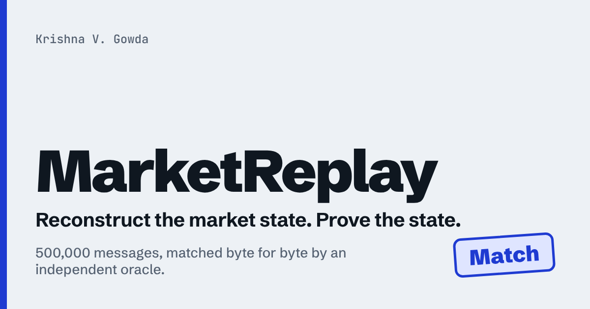
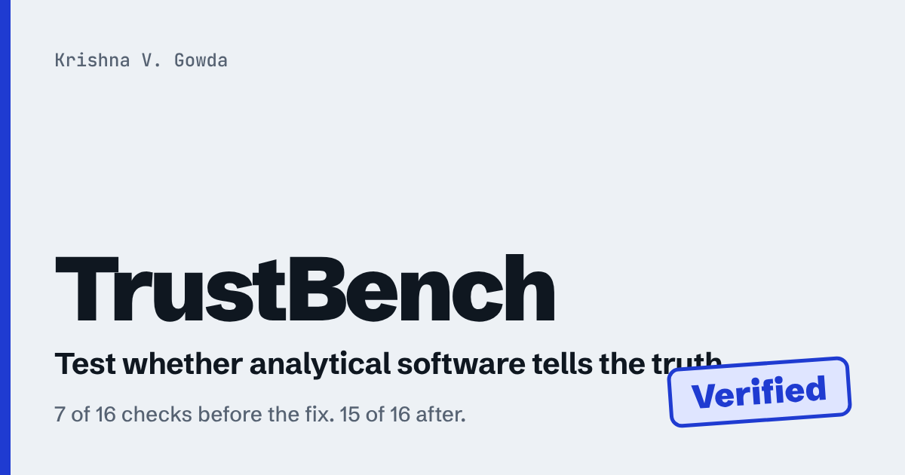
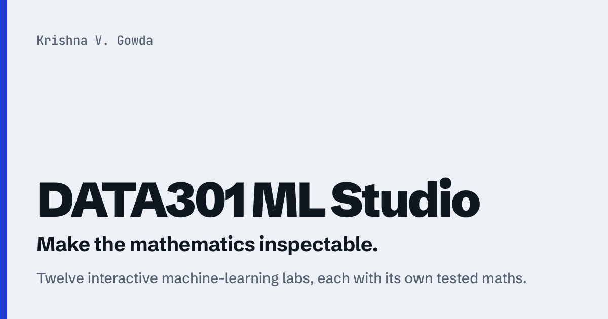
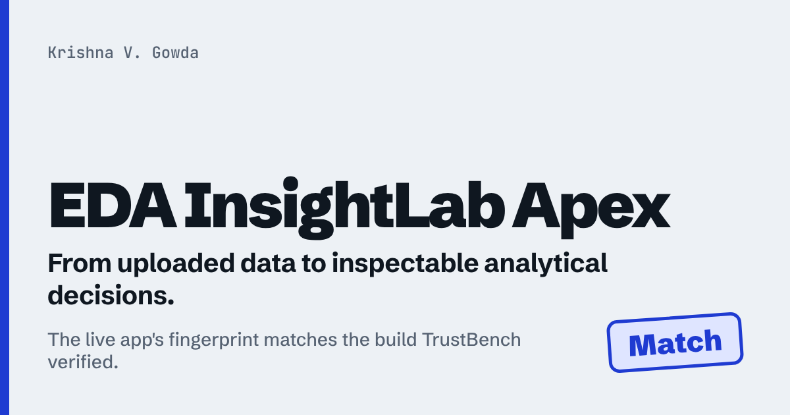

<picture>
  <source media="(prefers-color-scheme: dark)" srcset="assets/header-dark.svg">
  
</picture>

I'm Krishna, a computer science student in Bengaluru and the co-founder and CTO of [KRIVANCE](https://krivance.com/). I build software that can prove its own results, and I put the proof where you can run it yourself.

**[Open my portfolio](https://krishna-v-gowda.github.io/)** to watch it happen: your browser re-checks a public, Bitcoin-timestamped forecast record, refuses a settlement that is ₹1.37 short, and replays an exchange feed with a correctness check after every message.

## The work

<table>
<tr>
<td width="50%" valign="top">

<b><a href="https://github.com/Krishna-V-Gowda/proofloom">Proofloom</a></b>: a payments settlement close where a model ranks messy evidence, but fixed money rules and a human decide. A 137-paise gap blocks the close.
</td>
<td width="50%" valign="top">

<b><a href="https://github.com/Krishna-V-Gowda/MarketReplay">MarketReplay</a></b>: a C++20 engine that rebuilds an exchange's order book from its binary feed, matched byte for byte by an independent Python implementation.
</td>
</tr>
<tr>
<td width="50%" valign="top">

<b><a href="https://github.com/Krishna-V-Gowda/TrustBench">TrustBench</a></b>: checks the exact code an analytics app ships against independent statistics libraries. It took <a href="https://github.com/Krishna-V-Gowda/EDA-InsightLab-Apex">Apex</a> from 7 to 15 of 16 checks.
</td>
<td width="50%" valign="top">

<b><a href="https://github.com/Krishna-V-Gowda/RiskLab">RiskLab</a></b>: six ways of splitting money across assets, run through a simulated crash with real trading costs, to see which holds up and whether the difference is real.
</td>
</tr>
<tr>
<td width="50%" valign="top">

<b><a href="https://github.com/Krishna-V-Gowda/DATA301-ML-Studio">DATA301 ML Studio</a></b>: twelve interactive machine-learning labs for a university course, each built on a small, separately tested maths module.
</td>
<td width="50%" valign="top">

<b><a href="https://github.com/Krishna-V-Gowda/EDA-InsightLab-Apex">EDA InsightLab Apex</a></b>: a data-exploration app that runs entirely in your browser. The live build is fingerprinted against what TrustBench verified.
</td>
</tr>
</table>

Also: [Dayflow](https://github.com/Krishna-V-Gowda/dayflow-hrms), an HR system that shows how approving a leave changes team coverage before anyone decides.

## How I work

1. Write down exactly what each number means before measuring anything.
2. Build a second, independent way to compute it, so silent mistakes surface.
3. Break the system on purpose: bad input, outages, future data leaking backwards.
4. Publish the limits next to the result.

## Get in touch

[kris7090779999@gmail.com](mailto:kris7090779999@gmail.com) · [Portfolio](https://krishna-v-gowda.github.io/) · [KRIVANCE](https://krivance.com/)
