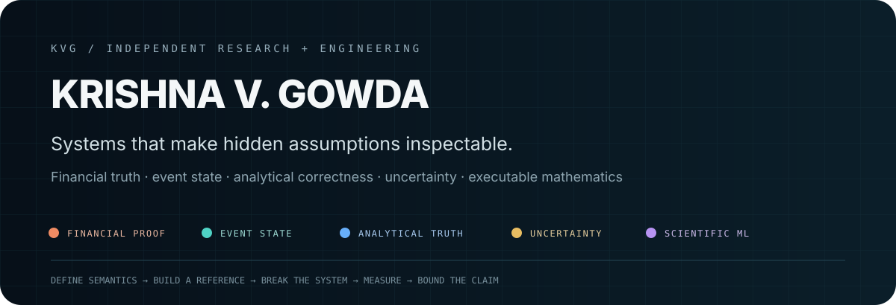
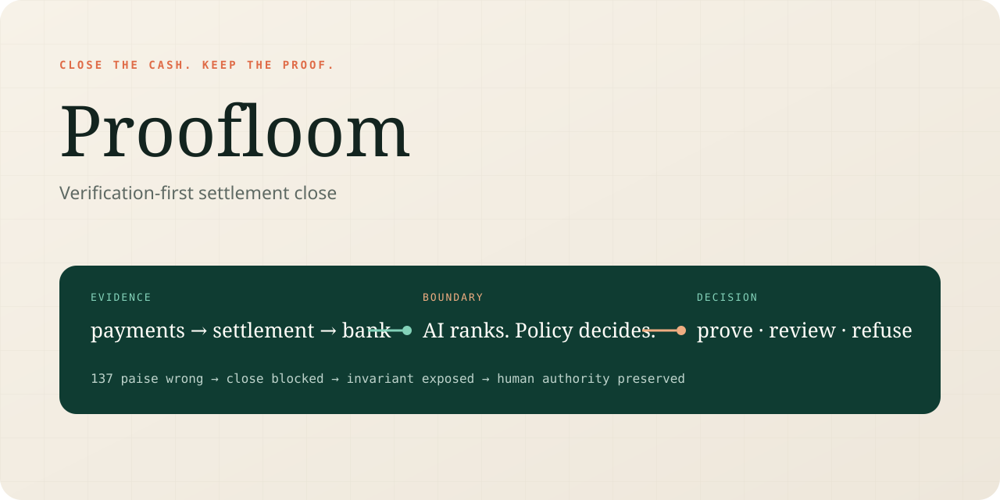
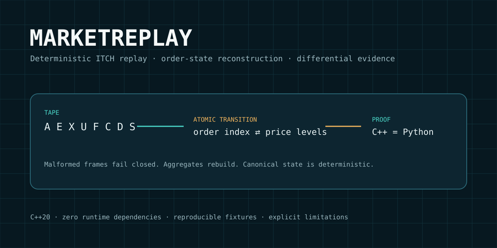
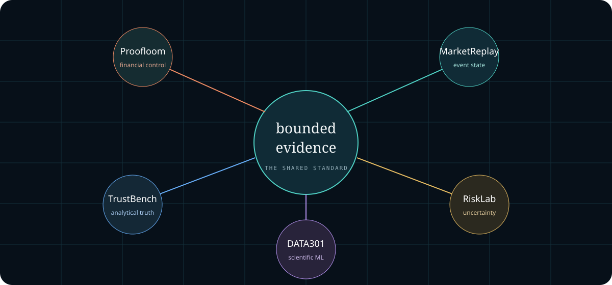

<p align="center">
  
</p>

I build systems where consequential assumptions become **state, invariants, independent references, controlled experiments, and explicit limits**. The projects below span financial controls, market infrastructure, analytical reliability, quantitative research, and scientific machine learning—but share one standard: every important claim should terminate in an artifact you can inspect or execute.

<p align="center">
  <a href="https://krishna-v-gowda.github.io/"><strong>Systems atlas</strong></a>
  &nbsp;·&nbsp;
  <a href="mailto:kris7090779999@gmail.com"><strong>Contact</strong></a>
  &nbsp;·&nbsp;
  Bengaluru, India
</p>

## Start here

<table>
<tr>
<td width="50%" valign="top">
<a href="https://github.com/Krishna-V-Gowda/proofloom"></a>

### [Proofloom](https://github.com/Krishna-V-Gowda/proofloom)
**Financial truth under ambiguity.** A verification-first settlement close where AI ranks damaged evidence, deterministic financial invariants retain authority, and a 137-paise contradiction blocks the close.

`FastAPI` · `financial controls` · `human-in-the-loop` · `auditability`
</td>
<td width="50%" valign="top">
<a href="https://github.com/Krishna-V-Gowda/MarketReplay"></a>

### [MarketReplay](https://github.com/Krishna-V-Gowda/MarketReplay)
**Reconstruct the market state. Prove the state.** C++20 replay for a bounded ITCH subset, checked against an independently implemented Python oracle and a retained 500,000-message workload.

`C++20` · `binary protocols` · `state machines` · `differential testing`
</td>
</tr>
</table>

## The evidence stack

| System | Question it makes inspectable | Evidence worth opening |
|---|---|---|
| **[TrustBench](https://github.com/Krishna-V-Gowda/TrustBench)** × **[Apex](https://github.com/Krishna-V-Gowda/EDA-InsightLab-Apex)** | Is the analytical product actually computing what it claims? | Exact shipped source, independent statistical references, counterexamples, and a measured defect-to-repair transition. |
| **[RiskLab](https://github.com/Krishna-V-Gowda/RiskLab)** | Which allocation decisions survive estimation error, regime change, turnover, costs, and tail risk? | Six allocation rules, strict trailing windows, paired block-bootstrap uncertainty, and an adverse synthetic result retained rather than tuned away. |
| **[DATA301 ML Studio](https://github.com/Krishna-V-Gowda/DATA301-ML-Studio)** | Can interactive ML remain mathematically inspectable? | Twelve laboratories, framework-independent TypeScript numerical cores, and 36 source tests including metamorphic properties. |

<p align="center">
  
</p>

## How I work

```text
define semantics
    ↓
build an independent reference
    ↓
break the system on purpose
    ↓
measure behavior and uncertainty
    ↓
bound the public claim
```

This means malformed frames are first-class MarketReplay inputs; synthetic negative results remain visible in RiskLab; exact browser source—not rewritten formulas—is the TrustBench subject; and Proofloom's model never receives authority to repair financial truth.

## Current focus

Reliable AI around consequential workflows · event-driven and low-level systems · quantitative methods under uncertainty · executable evaluation and reproducibility.

## Contact

[kris7090779999@gmail.com](mailto:kris7090779999@gmail.com) · [krishna-v-gowda.github.io](https://krishna-v-gowda.github.io/)
