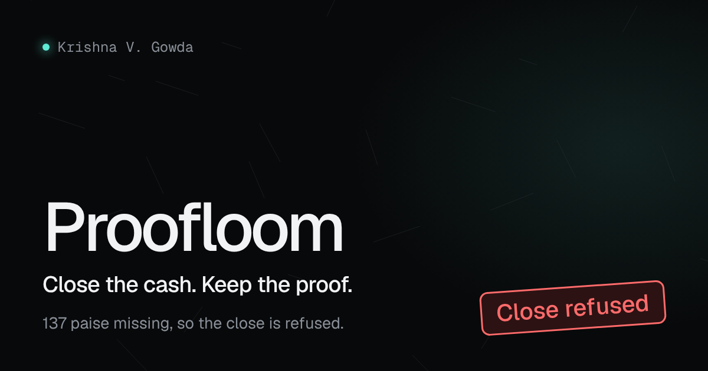
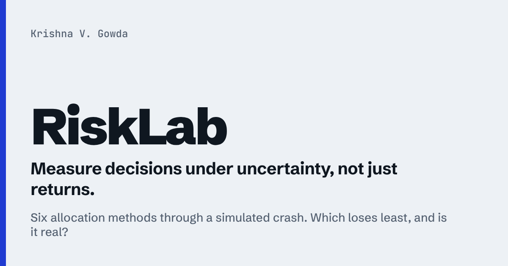
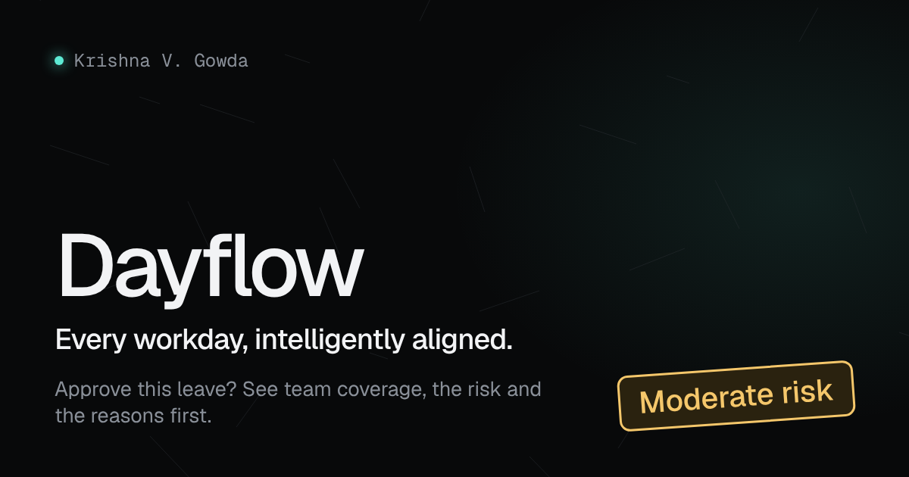
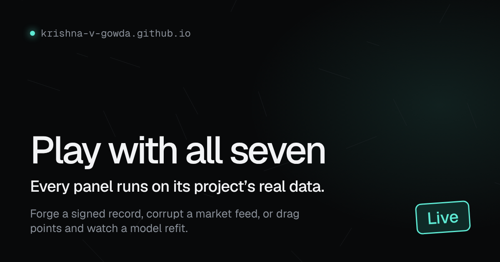
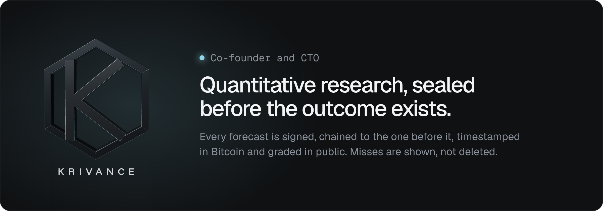

**Second Prize (State Level), CAG–ICSSR Research Article Competition 2026** for *“Alignment is not realignment: a post-audit test of KKRDB’s geographic need responsiveness”*.

I build software that can prove its own results, and I put the proof where you can run it yourself. On my portfolio your browser re-checks a signed, Bitcoin-timestamped forecast record, and every project below has a live panel running on its real data.

## The work

<table>
<tr>
<td width="50%" valign="top"> <b><a href="https://github.com/Krishna-V-Gowda/proofloom">Proofloom</a></b>: refuses to close books that are 137 paise short.</td>
<td width="50%" valign="top"> <b><a href="https://github.com/Krishna-V-Gowda/MarketReplay">MarketReplay</a></b>: rebuilds an exchange's order book in C++20, matched byte for byte by a second implementation.</td>
</tr>
<tr>
<td width="50%" valign="top"> <b><a href="https://github.com/Krishna-V-Gowda/TrustBench">TrustBench</a></b>: tests shipped analytics code against reference libraries, and took Apex from 7 to 15 of 16 checks.</td>
<td width="50%" valign="top"> <b><a href="https://github.com/Krishna-V-Gowda/EDA-InsightLab-Apex">EDA InsightLab Apex</a></b>: data exploration that runs entirely in your browser.</td>
</tr>
<tr>
<td width="50%" valign="top"> <b><a href="https://github.com/Krishna-V-Gowda/RiskLab">RiskLab</a></b>: six ways to split money across assets, run through a simulated crash with real trading costs.</td>
<td width="50%" valign="top"> <b><a href="https://github.com/Krishna-V-Gowda/DATA301-ML-Studio">DATA301 ML Studio</a></b>: twelve interactive machine-learning labs for a university course.</td>
</tr>
<tr>
<td width="50%" valign="top"> <b><a href="https://github.com/Krishna-V-Gowda/dayflow-hrms">Dayflow</a></b>: shows HR what approving a leave does to team coverage, before they decide.</td>
<td width="50%" valign="top"> <b><a href="https://krishna-v-gowda.github.io/#systems">All seven, live</a></b>: forge, corrupt, drag and scrub them on my portfolio.</td>
</tr>
</table>

## KRIVANCE

## How I work

- Write down exactly what each number means before measuring anything.
- Build a second, independent way to compute it, so silent mistakes surface.
- Break the system on purpose: bad input, outages, future data leaking backwards.
- Publish the limits next to the result.
